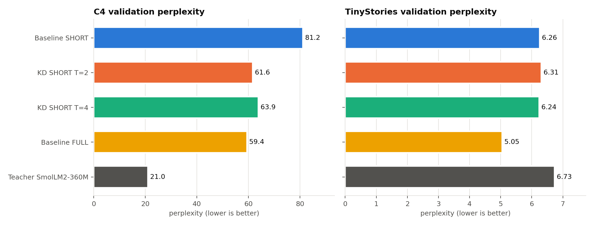
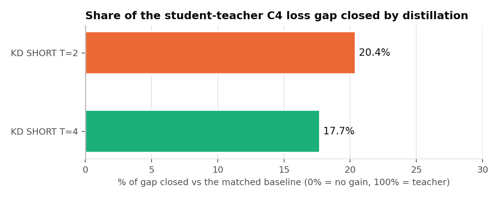
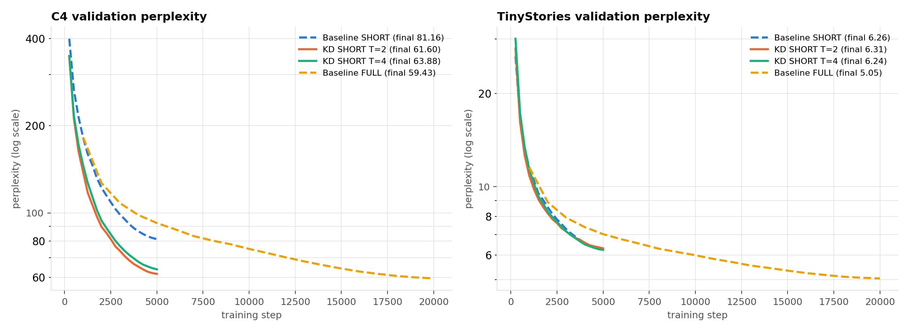
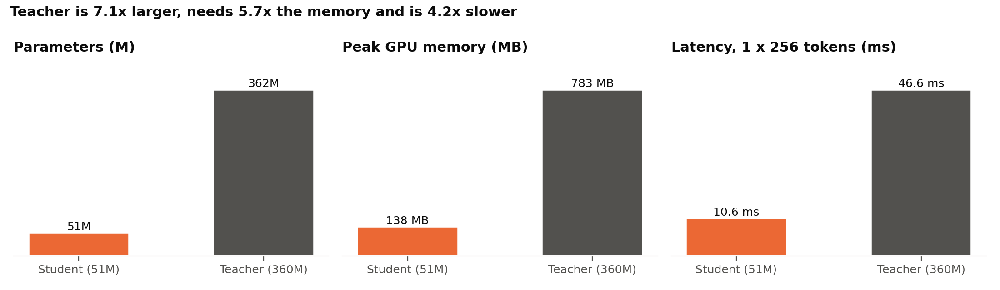
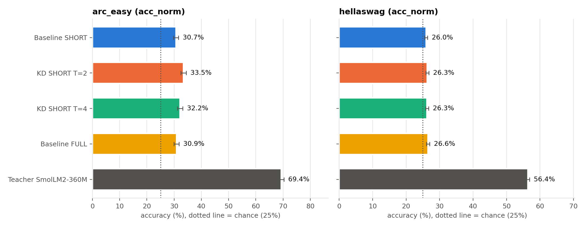
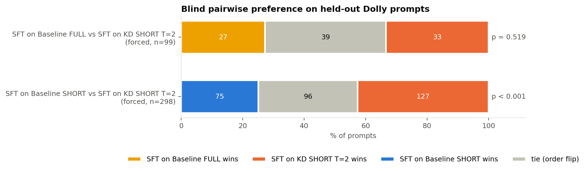

# TENSORIX final evaluation

Generated by `src/final_report.py`. Do not edit by hand: rerun the script when new result files arrive.

## 1. Language-modelling quality (fixed validation windows, lower is better)

1,024 windows of 256 tokens per domain, seed 0, identical for every model. Gap closed on C4 = (loss_baseline - loss_model) / (loss_baseline - loss_teacher), against the baseline of the same tier. It is not computed on TinyStories, where the teacher is worse than the students.

| Model | Tier | Step | C4 loss | C4 ppl | C4 ppl vs tier baseline | TinyStories loss | TinyStories ppl | TS ppl vs tier baseline | Gap closed on C4 | Source |
|---|---|---|---|---|---|---|---|---|---|---|
| Baseline SHORT | SHORT | 5000 | 4.3964 | 81.2 | reference | 1.8342 | 6.26 | reference | 0% (reference) | evaluate.py |
| KD SHORT T=2 | SHORT | 5000 | 4.1207 | 61.6 | -24.1% | 1.8425 | 6.31 | +0.8% | 20.4% | evaluate.py |
| KD SHORT T=4 | SHORT | 5000 | 4.1571 | 63.9 | -21.3% | 1.8314 | 6.24 | -0.3% | 17.7% | evaluate.py |
| Baseline FULL | FULL | 20000 | 4.0848 | 59.4 | reference | 1.6188 | 5.05 | reference | 0% (reference) | evaluate.py |
| Teacher SmolLM2-360M | - | - | 3.0466 | 21.0 | - | 1.9067 | 6.73 | - | - | evaluate.py |

## 2. Efficiency: student versus teacher

One forward pass of 1 x 256 tokens in fp16 on Tesla T4 (median of 20). Every student has the same architecture, so size and memory are identical across students; latency differs only by measurement noise.

| Model | Parameters | fp16 weights | Peak GPU memory | Latency (1 x 256) |
|---|---|---|---|---|
| Baseline SHORT | 50.86M | 101.7 MB | 138.5 MB | 11.1 ms |
| KD SHORT T=2 | 50.86M | 101.7 MB | 138.5 MB | 12.4 ms |
| KD SHORT T=4 | 50.86M | 101.7 MB | 138.5 MB | 9.4 ms |
| Baseline FULL | 50.86M | 101.7 MB | 138.5 MB | 9.6 ms |
| Teacher SmolLM2-360M | 361.82M | 723.6 MB | 782.9 MB | 46.6 ms |

Teacher / student: **7.1x** parameters, **5.7x** peak memory, **4.2x** latency (student latency range 9.4 to 12.4 ms across 4 students).

## 3. Zero-shot benchmarks (higher is better)

Log-likelihood multiple choice as in lm-evaluation-harness; acc_norm divides by answer length. +/- is one standard error. Random guessing gives about 25%.

| Model | arc_easy acc | arc_easy acc_norm | hellaswag acc | hellaswag acc_norm |
|---|---|---|---|---|
| Baseline SHORT | 30.1 +/- 0.9 | 30.7 +/- 0.9 | 26.3 +/- 0.4 | 26.0 +/- 0.4 |
| KD SHORT T=2 | 35.2 +/- 1.0 | 33.5 +/- 1.0 | 26.4 +/- 0.4 | 26.3 +/- 0.4 |
| KD SHORT T=4 | 34.5 +/- 1.0 | 32.2 +/- 1.0 | 26.4 +/- 0.4 | 26.3 +/- 0.4 |
| Baseline FULL | 31.0 +/- 0.9 | 30.9 +/- 0.9 | 26.6 +/- 0.4 | 26.6 +/- 0.4 |
| Teacher SmolLM2-360M | 70.3 +/- 0.9 | 69.4 +/- 0.9 | 43.2 +/- 0.5 | 56.4 +/- 0.5 |

Examples per task: arc_easy 2376, hellaswag 10042.

## 4. Instruction fine-tuning (Dolly 15k validation, 592 examples)

Response-only cross-entropy of each model's selected checkpoint (lowest validation loss). Same data split, prompt template and hyperparameters for every run. Not comparable with C4/TinyStories losses.

| Run | Updates | Best update | Best val loss | Final val loss |
|---|---|---|---|---|
| `sft_dolly_baseline_v3` | 1350 | 300 | 3.3473 | 3.4733 |
| `sft_dolly_baseline_short_v1` | 1350 | 700 | 3.6863 | 3.7592 |
| `sft_dolly_kd_short_T2_v1` | 1350 | 300 | 3.3007 | 3.4586 |

## 5. Answer statistics on 300 held-out Dolly prompts

Same prompts, decoding settings and random seed per prompt for every model. Word F1 is unigram overlap with the human reference answer (closer to the reference, not necessarily better).

| Model | Mean words | Empty | Repeated 3-gram | Distinct bigrams | Word F1 vs reference |
|---|---|---|---|---|---|
| SFT on Baseline SHORT | 36.0 | 0.0% | 52.0% | 51.1% | 0.201 |
| SFT on KD SHORT T=2 | 36.8 | 0.0% | 59.7% | 53.1% | 0.215 |
| SFT on Baseline FULL | 36.7 | 0.0% | 60.0% | 51.8% | 0.229 |

## 6. Blind pairwise preference (LLM judge, both answer orders)

A model wins a prompt only if the judge picks it in both orders; otherwise the prompt is a tie. Interval: 95% Wilson interval for the leader's share of decisive prompts. p: exact two-sided sign test.

| Pair | Protocol | Judge | Prompts | First wins | Second wins | Ties (of which order flips) | Leader's win rate (excl. ties) | 95% interval | Sign-test p |
|---|---|---|---|---|---|---|---|---|---|
| SFT on Baseline FULL vs SFT on KD SHORT T=2 | forced choice | gemini-3.1-flash-lite | 99 | 27 | 33 | 39 (39) | 55.0% (SFT on KD SHORT T=2) | 42% to 67% | 0.519 |
| SFT on Baseline SHORT vs SFT on KD SHORT T=2 | forced choice | gemini-3.1-flash-lite | 298 | 75 | 127 | 96 (96) | 62.9% (SFT on KD SHORT T=2) | 56% to 69% | < 0.001 |

## Figures

## Limitations

* One training seed per configuration: differences of a few hundredths in loss are within run-to-run noise.
* SHORT-tier runs (5,000 steps) are compared only with `baseline_short`, FULL-tier runs only with `baseline_full`.
* Benchmarks at this model size sit close to chance; treat small differences with the standard errors in mind.
* The LLM judge is a single model; its position bias shows up as order flips (counted as ties).
